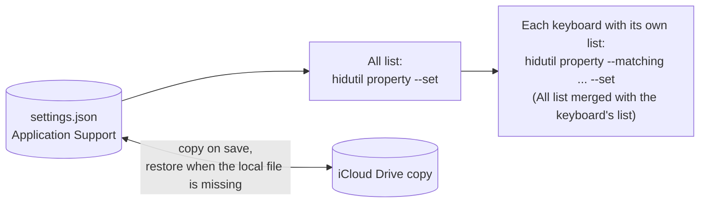

<div align="center">


# SimpleMapper

**A lightweight key remapper for macOS, a simple alternative to Karabiner-Elements.**

[](https://github.com/dinhanhthi/SimpleMapper/releases/latest)
[](https://github.com/dinhanhthi/SimpleMapper/releases)

[](LICENSE)

### [Download for macOS](https://github.com/dinhanhthi/SimpleMapper/releases/latest)

<picture>
  <source media="(prefers-color-scheme: dark)" srcset="assets/screenshots/main-dark.png">
  
</picture>

</div>

## Features

- Remap any key to any other key ([key names](docs/KEYS.md), as in Karabiner-Elements).
- Mappings for all keyboards or per keyboard; a keyboard's own mapping wins over the All one ([how](#all-keyboards-and-one-keyboard)).
- On/off switch per mapping, and Detect key to identify a key or its keyboard.
- Import/export as JSON, with an automatic iCloud Drive backup.
- Menu bar status, Launch at login, automatic updates.
- [Light on resources](#resource-usage). No kernel extension, driver or Accessibility permission.

## Install

Download the `.dmg` from [Releases](https://github.com/dinhanhthi/SimpleMapper/releases/latest), drag SimpleMapper to `/Applications` and launch it. Requires macOS 14 or later; updates come through Sparkle.

## How it works



- SimpleMapper sets Apple's `UserKeyMapping` with `/usr/bin/hidutil` ([equivalent commands](docs/KEYS.md#equivalent-command)). Mappings are re-applied at launch and when a keyboard connects; Quit clears them.
- Settings live in `~/Library/Application Support/SimpleMapper/settings.json`, copied to `iCloud Drive/SimpleMapper/` on every save. The iCloud copy is read only when the local file is missing (reinstall, new Mac); there is no live sync between Macs.
- Only Detect key needs Input Monitoring, and it listens for a single key (10 seconds max).

### All keyboards and one keyboard

- A keyboard's list shows every All mapping it has not deleted (its own row replaces the All one on the same key), plus its own. A From key appears once per list: adding it a second time is refused.
- On a keyboard, a card whose From key is in the All list has a dot: green when its To and on/off equal the All mapping, gray when they differ. Clicking a gray dot takes the All values again.
- Changing a card's From, To or switch on a keyboard gives that keyboard its own copy, which later All edits no longer change. Picking the All values again makes it follow All. Switching a card off on a keyboard turns that key off there, even if All maps it.
- Deleting a card on a keyboard removes that key from this keyboard only (the All mapping no longer applies there); + adds it back.
- Deleting an All mapping also removes its green cards on every keyboard; gray cards (own values) stay.
- In All keyboards, the stack button on a card makes every keyboard use that mapping again (after a confirmation): their own copies and deletions of that key are dropped.

## Resource usage

One mapping (`non_us_backslash` → `grave_accent_and_tilde`), measured on 2026-10-16 with macOS 27.0.1, SimpleMapper 1.0.0 and Karabiner-Elements 16.3.0 (`top` MEM column).

| State | SimpleMapper | Karabiner-Elements (all processes) |
| --- | --- | --- |
| Idle in the background | **14 MB**, 0% CPU | **72 MB**, ~1% CPU |
| Settings window open | **34 MB**, 0% CPU | **130 MB**, ~1% CPU |
| Typing, window closed | **34 MB**, 0% CPU | **73 MB**, 2.3% CPU |

Typing costs SimpleMapper nothing because macOS does the remapping. Once opened, the window keeps SwiftUI and Metal loaded (~20 MB) until relaunch. Run `scripts/measure.sh` to compare on your Mac.

## FAQ

**Can I use it with Karabiner-Elements?**
Not at the same time: Karabiner seizes keyboards, so quit it first.

**My ISO keyboard's section sign and backtick keys are swapped.**
macOS may swap `non_us_backslash` and `grave_accent_and_tilde` on ISO keyboards. Use Detect key to see what a key sends.

**Does it reset other tools' mappings?**
Yes, it replaces any `UserKeyMapping` set by other tools or by hand.

**How do I uninstall it?**
Quit from the menu bar menu (this clears the mappings) and delete the app. Optionally delete `~/Library/Application Support/SimpleMapper` and `iCloud Drive/SimpleMapper`.

## Development

```sh
brew install xcodegen
scripts/dev.sh                # generate the project, build Debug, launch
xcodebuild test -project SimpleMapper.xcodeproj -scheme SimpleMapper
scripts/screenshots.sh        # README screenshots (Debug demo mode, never touches your settings)
```

Issues and pull requests are welcome, see [CONTRIBUTING.md](CONTRIBUTING.md). Releases are maintainer-only, see [docs/RELEASING.md](docs/RELEASING.md).

## License

MIT, see [LICENSE](LICENSE).
