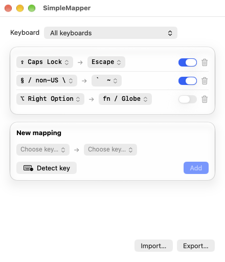
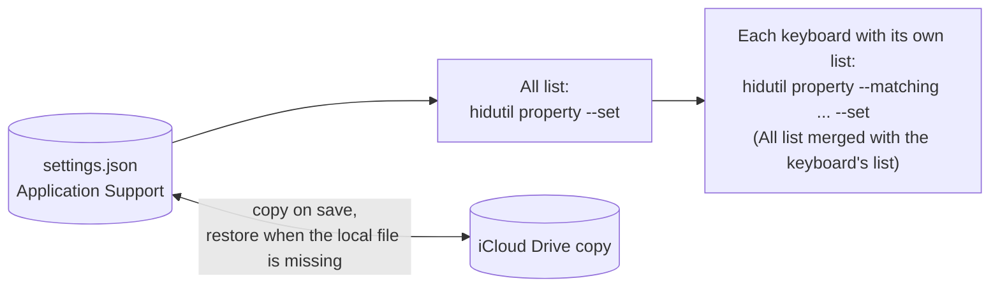

<div align="center">


# SimpleMapper

**A lightweight key remapper for macOS and a simple alternative to Karabiner-Elements: remap keys for all keyboards or per keyboard, from a clean window, with iCloud-synced settings.**

[](https://github.com/dinhanhthi/SimpleMapper/releases/latest)
[](https://github.com/dinhanhthi/SimpleMapper/releases)

[](LICENSE)

### [Download for macOS](https://github.com/dinhanhthi/SimpleMapper/releases/latest)

<picture>
  <source media="(prefers-color-scheme: dark)" srcset="assets/screenshots/main-dark.png">
  
</picture>

</div>

## Features

- Remap any key to any other key, named as in Karabiner-Elements ([full list](docs/KEYS.md)).
- Mappings for All keyboards or for a specific keyboard, built-in or external. When both define the same From key, the keyboard's own mapping wins.
- On/off switch per mapping.
- Detect key: press a key to identify it, or to select the keyboard it came from.
- Import and export the settings as JSON.
- Settings are backed up to iCloud Drive and restored after a reinstall or on a new Mac.
- Menu bar status ("N mappings active"), Launch at login, automatic updates (Sparkle).
- Light on resources, see [Resource usage](#resource-usage).
- No kernel extension, no driver, no Accessibility permission.

## Install

1. Download the notarized `SimpleMapper-X.Y.Z.dmg` from [GitHub Releases](https://github.com/dinhanhthi/SimpleMapper/releases/latest).
2. Open it and drag SimpleMapper to `/Applications`.
3. Launch it. The window opens; a fresh install has no mappings yet.

SimpleMapper updates itself via Sparkle. To check manually, use Check for Updates in the menu bar menu. Requires macOS 13 or later.

## Usage

### The window

- **Keyboard** dropdown (top): All keyboards, or one connected keyboard. A keyboard with saved mappings stays in the list, marked "(not connected)", while it is unplugged.
- **List**: one row per mapping, From, an arrow and To. Click a key to change it. Each row has an on/off switch and a delete button.
- **New mapping**: choose From and To, then Add. **Detect key** lets you press a key instead of searching for it, then use it as From, as To, or select its keyboard. Add replaces the To key when that From key is already in the list.
- **Import / Export** (bottom right): save the settings to a JSON file, or replace everything from one.

### The menu bar

SimpleMapper lives in the menu bar. Its menu has:

- Open SimpleMapper
- Launch at login
- "N mappings active" (or the last error)
- Check for Updates...
- About SimpleMapper
- Quit, with a "Sure to quit" item so you do not quit by accident


The Dock icon shows only while the window is open; closing the window leaves the menu bar icon. With Launch at login on, SimpleMapper starts in the menu bar only.

## How it works



- SimpleMapper sets Apple's `UserKeyMapping` with `/usr/bin/hidutil`. First the All list is set for every keyboard, then each keyboard with its own list gets the merged list. The equivalent commands are in [docs/KEYS.md](docs/KEYS.md#equivalent-command).
- `hidutil` mappings do not survive a restart, so the app re-applies them at launch and whenever a keyboard is connected. Quit clears them.
- Settings live in `~/Library/Application Support/SimpleMapper/settings.json`. Every save also copies the file to `~/Library/Mobile Documents/com~apple~CloudDocs/SimpleMapper/settings.json` when iCloud Drive is on. The iCloud copy is read only when the local file is missing, which restores your settings after a reinstall or on a new Mac.
- There is no live sync between running Macs: the Mac that saved last owns the iCloud copy.
- Detect key asks for Input Monitoring the first time you use it. It listens only until one key is pressed (or 10 seconds pass), then stops.

## Resource usage

Measured on 2026-10-15, macOS 27.0.1, Release build, 10 samples of 1 second with `top`:

| | Memory | CPU |
| --- | --- | --- |
| SimpleMapper, menu bar only | 14.0 MB | 0.00% |
| SimpleMapper, window open | 33.9 MB | 0.00% |
| Karabiner-Elements, running processes (Core-Service 14.0 MB, VirtualHIDDevice-Daemon 5.9 MB, DriverKit extension 0.9 MB) | 20.8 MB | 0.07% |

Closing the window releases its UI; the "menu bar only" row was measured on a launch without the window. Numbers vary by macOS version. To reproduce, start SimpleMapper and Karabiner-Elements and run `scripts/measure.sh`.

## FAQ

**Can I use it together with Karabiner-Elements?**
Not at the same time. Karabiner seizes keyboards, so `hidutil` mappings have no effect while it runs. Quit Karabiner-Elements first.

**My ISO keyboard's section sign and backtick keys are swapped.**
On ISO keyboards macOS may swap `non_us_backslash` and `grave_accent_and_tilde`. Use Detect key to see what a key really sends.

**Does it need Accessibility permission?**
No. Only Detect key needs Input Monitoring, asked the first time you use it.

**macOS asked for access to iCloud Drive, or iCloud Drive is off.**
Allow it to get the iCloud copy. If you deny it or iCloud Drive is off, SimpleMapper keeps working with the local settings file only.

**Does it reset other tools' mappings?**
Yes. Applying or clearing mappings replaces any `UserKeyMapping` set by other tools or by hand with `hidutil`.

**How do I uninstall it?**
Choose Quit, then Sure to quit, from the menu bar menu (this clears the mappings), and delete SimpleMapper from `/Applications`. Optionally delete `~/Library/Application Support/SimpleMapper` and `~/Library/Mobile Documents/com~apple~CloudDocs/SimpleMapper`, and run `hidutil property --set '{"UserKeyMapping":[]}'` to be sure nothing is left.

## Development

```sh
brew install xcodegen
scripts/dev.sh                # generate the project, build Debug, launch
xcodebuild test -project SimpleMapper.xcodeproj -scheme SimpleMapper
scripts/measure.sh            # RAM and CPU vs Karabiner-Elements
scripts/screenshots.sh        # README screenshots
```

`scripts/screenshots.sh` runs a Debug-only demo mode that never touches your settings or keyboard. See [CONTRIBUTING.md](CONTRIBUTING.md) for setup, tests and code layout.

## Contributing

Issues and pull requests are welcome. Read [CONTRIBUTING.md](CONTRIBUTING.md) first.

## Releasing

Releases are local and maintainer-only: `/cf-ship`, see [docs/RELEASING.md](docs/RELEASING.md).

## License

MIT, see [LICENSE](LICENSE).
